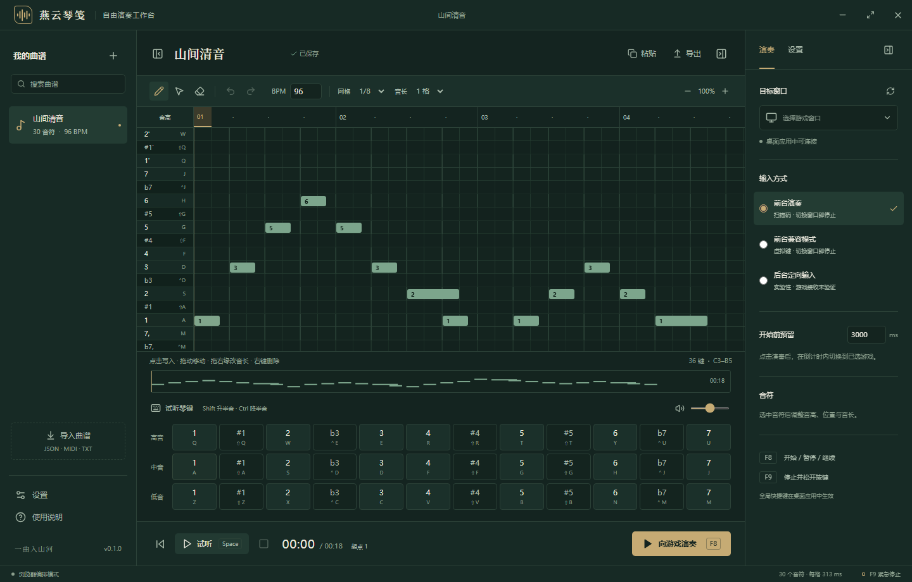

# 燕云琴笺

《燕云十六声》36 键自由演奏工作台。编排、试听与游戏演奏在同一应用完成。

面向 Windows x64 与 macOS 13 及以上版本（Apple Silicon / Intel）。

基于 [Kukisama 的 yysls-freeplay-arranger](https://github.com/Kukiisama/yysls-freeplay-arranger) 重构，使用 Rust、Tauri 2、React 与 TypeScript，沿用 MIT 协议。

[下载安装包](https://github.com/MIGO-OvO/yysls-auto-guqin/releases/latest) · [开发说明](docs/DEVELOPMENT.md) · [迁移对照](docs/MIGRATION.md) · [平台验收](docs/VALIDATION.md)



## 使用

1. 在左侧新建曲谱，点击中央钢琴卷写音符；拖动移动、拖右缘改音长、右键删除。
2. 设定 BPM、网格和音长。空格试听，`Ctrl/⌘+Z` 撤销，`Ctrl/⌘+Shift+Z` 重做。
3. 在演奏面板选择游戏窗口，进入游戏的 **36 键自由演奏**。
4. 点击“向游戏演奏”，在倒计时内切回游戏。`F8` 开始、暂停或继续；`F9` 停止并松键。快捷键可修改。

点击时间标尺可更改起点。曲库与设置自动保存在本机；关闭窗口默认留在托盘，托盘菜单可停止或退出。

## 导入与导出

支持旧项目 JSON、裸音符数组、MIDI 0/1、简谱、键位链和 TXT 命令。导入先预览，可替换或追加。MIDI 按当前网格量化，移八度到 C3–B5，同列和弦取最高音；速度变化换算为网格位置。

```text
1, 2, 3, 1 2 #4 5'
Q → W → Shift+Q×2 → Ctrl+E
```

```text
# TXT 命令：最后的数字是按住毫秒
KEY Q 250
KEY Shift+Q 500
250ms
KEY Ctrl+E 500
```

JSON 导出保留 `cols`、`timing` 和音符的 `col/len/midi/name/keys` 字段。TXT 支持原 C# 演奏器的字母、数字、F1–F12 与 Ctrl/Alt/Shift；36 键以外的命令显示在命令轨。简谱中的 `0` 和 `-` 各占一格休止。键位链的 `×N` 按原规则延长音符，下一 token 仍前进一格。

内置“山间清音”是原创练习旋律，用于检查编辑与试听。

## 输入与平台

| 模式 | 实现 | 使用条件 |
| --- | --- | --- |
| Windows 前台 | SendInput 扫描码 / 虚拟键 | 目标窗口保持前台；与游戏使用同等权限 |
| Windows 后台 | WM_KEYDOWN / WM_KEYUP 定向消息 | 实验性；游戏可能轮询键盘状态而忽略消息或修饰键 |
| macOS 前台 | Quartz 键盘事件 | 辅助功能与事件发送权限；目标应用保持前台 |
| macOS 后台 | CGEventPostToPid | 实验性；游戏实际接收待验证 |

**后台游戏演奏尚未验收。** 界面始终显示“游戏接收未验证”。Windows 普通接收窗口测试与游戏验收分别记录在[平台验收](docs/VALIDATION.md)。游戏不接收后台事件时，使用前台模式。

暂停、停止、正常退出、线程异常和目标丢失都会执行本程序已按键的松键清理。暂停后继续不重发暂停时的音符。操作系统强制终止进程或撤销输入权限时，清理代码可能无法执行或发送；演奏引擎不会在重连后自动恢复。

输入层使用系统公开 API，不读取游戏内存，不注入 DLL，不修改游戏文件。

## 自动更新与发布

启动时可检查 GitHub Releases，也可在设置中手动检查。更新面板展示版本、日志和下载进度；下载并校验签名后，由用户确认安装与重启。

推送 `v*` 标签会运行 GitHub Actions，分别构建 Windows x64 NSIS、macOS Apple Silicon 和 Intel 的 DMG 与签名更新包。所有目标构建成功后，工作流生成 `latest.json` 并发布完整 Release。更新公钥随应用分发，私钥放在 GitHub Secrets。

Tauri 更新签名与系统应用签名是两套机制。当前 macOS 使用 ad-hoc 签名；Developer ID 签名、公证及 Windows Authenticode 需要维护者的证书。配置方法见[开发说明](docs/DEVELOPMENT.md)。

## 开发

安装 Node.js 24、Rust stable 和 [Tauri 平台依赖](https://v2.tauri.app/start/prerequisites/)，然后运行：

```sh
npm ci
npm run tauri dev
```

```sh
npm run check
npx playwright install chromium
npm run test:e2e
cargo test --manifest-path src-tauri/Cargo.toml --locked
cargo clippy --manifest-path src-tauri/Cargo.toml --all-targets --locked -- -D warnings
```

`npm run dev` 仅开启浏览器编排与试听模式。窗口输入、托盘、全局快捷键和更新使用桌面应用验证。

原仓库完整快照保存在 `legacy/upstream-1895f25.zip`，对应提交 `1895f2542cace0e7a8bbbd2278da6c1b66592db4`。

## 许可证

[MIT](LICENSE)。保留上游作者 Kukisama 的版权声明。
